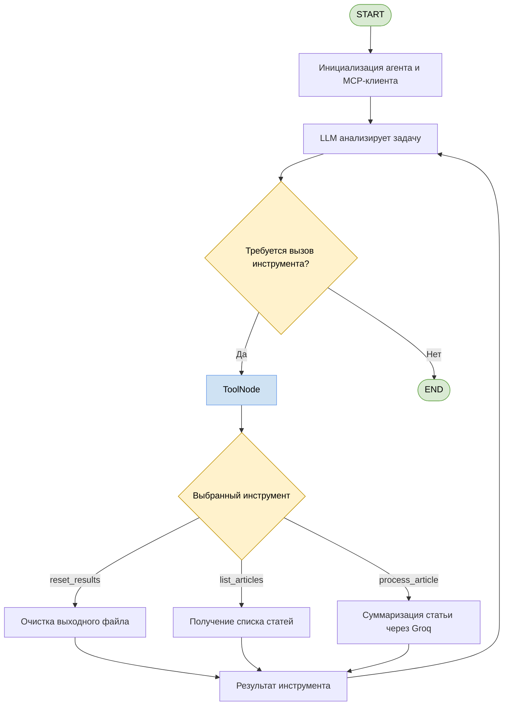

# MCP-агент для суммаризации статей

## 1. Описание проекта

Проект представляет собой автономного LLM-агента для автоматической суммаризации статей из JSON-файла. Агент самостоятельно выбирает и вызывает инструменты для получения списка статей, обработки документов и сохранения результатов.

**Используемые технологии:** Python, LangGraph, LangChain, MCP, FastMCP, Groq API, Langfuse.

## 2. Структура проекта

- `configs/agent.yaml` — конфигурация модели, путей к данным и промптов.
- `data/raw/articles.json` — исходные статьи.
- `data/processed/summaries.json` — результаты суммаризации.
- `scripts/main.py` — точка входа и запуск агента.
- `scripts/agent_graph.py` — создание агента, подключение MCP-инструментов и построение графа LangGraph.
- `scripts/mcp_server.py` — MCP-сервер, реализация инструментов и вызовы LLM.
- `scripts/view_results.py` — просмотр сохранённых результатов.
- `requirements.txt` — зависимости проекта.

## 3. Архитектура и инструменты

Агент построен на LangGraph и взаимодействует с MCP-сервером через `stdio`. MCP-клиент автоматически запускает сервер в отдельном процессе и получает список доступных инструментов.

Реализованы три MCP-инструмента:

- `reset_results` — создаёт или очищает выходной файл перед обработкой.
- `list_articles` — возвращает список идентификаторов доступных статей.
- `process_article` — генерирует краткое содержание статьи с помощью Groq API и сохраняет результат в JSON.

Основной сценарий работы: инициализация выходного файла → получение списка статей → обработка статей → сохранение результатов.

## 4. Граф выполнения агента



Граф отражает цикл работы агента: LLM выбирает инструмент, MCP-сервер выполняет действие и возвращает результат модели. Цикл повторяется до тех пор, пока модель не решит завершить работу.

Конкретные вызовы инструментов определяются моделью на основе системного промпта и результатов предыдущих действий.

## 5. Интеграция Langfuse

В проект добавлена интеграция с **Langfuse** для мониторинга генераций LLM при суммаризации статей.

Для каждого вызова модели фиксируются название модели, входной промпт и результат генерации. Это позволяет отслеживать работу суммаризации и анализировать результаты через LLM-as-a-Judge.

## 6. Запуск проекта

### Установка зависимостей

Создание виртуального окружения и установка необходимых библиотек:

```bash
python3 -m venv .venv
source .venv/bin/activate
pip install -r requirements.txt
```


### Настройка переменных окружения


```bash
export GROQ_API_KEY="key"
export LANGFUSE_PUBLIC_KEY="key"
export LANGFUSE_SECRET_KEY="key"
export LANGFUSE_BASE_URL="url"
```

### Запуск агента

Из корневой директории проекта:

```bash
python scripts/main.py
```

MCP-сервер запускается автоматически MCP-клиентом, поэтому отдельно запускать `mcp_server.py` не требуется.

Результаты сохраняются в `data/processed/summaries.json`. 

## 7. Выводы

- В проекте реализован агентный подход к суммаризации документов с использованием LangGraph и MCP. Оркестрация отделена от исполнения инструментов, что упрощает расширение функциональности и повторное использование компонентов.

- Интеграция с Langfuse обеспечивает мониторинг генераций LLM. При этом полнота обработки всех статей зависит от выполнения агентом заданных инструкций.
